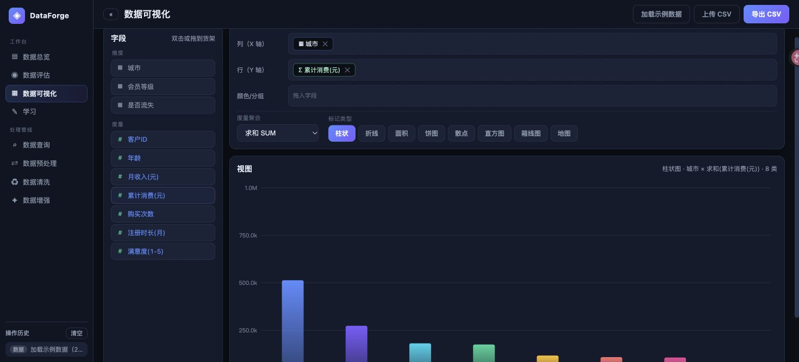
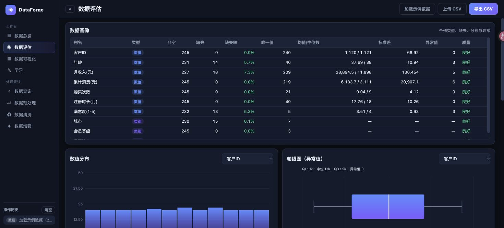
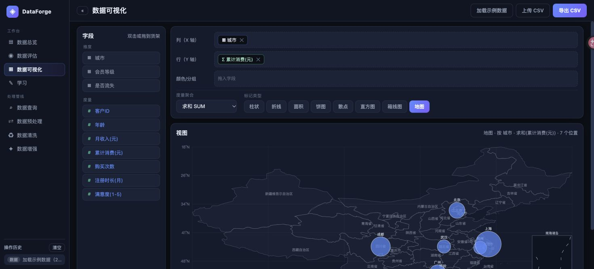
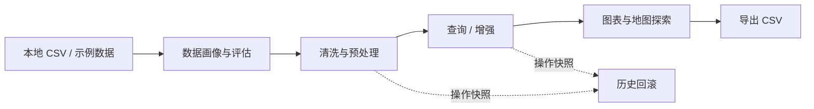

<div align="center">

# ◈ DataForge

### 从一份 CSV，到清晰、干净、可探索的数据。

浏览器端数据清洗与可视化工作台。无需账号，无需后端，无需安装依赖。

**原生 JavaScript · Canvas 图表 · 本地数据处理 · 中文界面**

[快速开始](#快速开始) · [功能一览](#功能一览) · [界面预览](#界面预览) · [开发文档](docs/DEVELOPMENT.md)

</div>



## 为什么选择 DataForge

处理一份表格，不必先搭建一套数据工程环境。DataForge 把数据画像、清洗、预处理、查询和图表放在同一个工作台里，适合日常 CSV 整理、探索性分析与统计教学。

- **打开即用**：纯静态 HTML / CSS / JavaScript，无构建流程，无运行时第三方依赖。
- **数据留在本地**：CSV 通过 FileReader 读取，计算在浏览器内完成；应用没有数据上传接口。
- **看得见每一步**：实时预览、操作历史和快照回滚，让数据变换有迹可循。
- **从操作到理解**：内置学习模块，解释缺失值、异常值、标准化与采样方法。

## 快速开始

下载仓库 ZIP 并解压，直接用现代浏览器打开 `index.html` 即可体验。也可以使用本地静态服务器：

```bash
git clone https://github.com/t0mAto1104/dataforge.git
cd dataforge
python3 -m http.server 3030 --bind 127.0.0.1
```

浏览器访问 [http://127.0.0.1:3030/](http://127.0.0.1:3030/)。Python 仅用于提供静态文件，应用本身不依赖 Python。

### 第一次使用

1. 点击 **加载示例数据**，或上传自己的 UTF-8 CSV。
2. 在 **数据评估** 中查看缺失、异常、分布与相关性。
3. 按需执行 **数据清洗 / 数据预处理**，选择操作及作用列。
4. 在 **数据可视化** 中双击或拖动字段到货架，选择图表类型。
5. 点击 **导出 CSV** 保存结果；需要撤销时，从左侧操作历史回滚。

> 查询执行后会更新当前数据集。页面刷新或关闭后，当前数据与历史不会自动恢复，请及时导出。

## 功能一览

| 模块 | 可以做什么 |
| :--- | :--- |
| 数据总览 | 查看行列规模、缺失率、重复行与字段类型 |
| 数据评估 | 逐列画像、质量分级、直方图、箱线图、Pearson 相关热力图 |
| 数据可视化 | 字段货架、维度/度量、聚合与分组；柱状、折线、面积、饼图、散点、直方图、箱线图 |
| 地图可视化 | 识别内置地点名称或经纬度字段，展示气泡地图与简化中国底图 |
| 数据查询 | 选列、多条件筛选、排序、限行、分组聚合；由界面构建，无需输入 SQL |
| 数据预处理 | 缺失值填充、Z-score / Min-Max、标签编码、One-Hot、删列与删缺失行 |
| 数据清洗 | 完全重复行去重、IQR / Z-score 异常处理、字符串修剪与类别名称统一 |
| 数据增强 | SMOTE、高斯噪声、样本复制、Bootstrap 重采样 |
| 学习与回滚 | 方法说明、实时数据预览、操作日志及快照恢复 |

## 界面预览

### 数据画像与质量评估



### 地理分布



截图使用应用内生成的合成客户数据，仅用于展示功能。

## 工作方式



以上是建议工作顺序，各模块可根据需要自由切换。

## 技术结构

```text
dataforge/
├── index.html              # 单页入口
├── css/style.css           # 深色界面与响应式样式
├── js/app.js               # 状态、交互、查询、管线与回滚
├── js/lib/
│   ├── stats.js            # 统计函数与 DataUtil
│   ├── data.js             # CSV 解析与示例数据
│   ├── algo.js             # 画像、清洗、预处理与增强算法
│   ├── charts.js           # Canvas 图表
│   ├── geo.js              # 地点名称与坐标
│   └── china-geo.js        # 简化地图轮廓
├── scripts/                # 开发辅助脚本
└── docs/                   # 开发文档与产品截图
```

实现采用现代 JavaScript 与 IIFE 模块组织。没有框架、数据库或远端分析服务。详细的数据模型和扩展方式见 [开发文档](docs/DEVELOPMENT.md)。

## 当前边界

- **CSV**：支持逗号分隔、表头、引号内逗号和转义双引号；暂不支持引号内跨行字段，也不直接读取 Excel 文件。
- **自动类型转换**：空值、`null`、`na`、`nan` 会作为缺失值；可转为数字的文本会转成数值，带前导零的编号需特别留意。
- **数据规模**：全量数据及历史快照保存在内存中；大文件和密集计算可能阻塞界面，尚无大规模性能承诺。
- **统计解释**：相关不代表因果；异常值、编码与增强策略需要结合数据语义选择。
- **地图**：内置地点库覆盖有限，底图为简化展示数据，不用于精确地理测量。
- **持久化**：暂不支持自动保存项目、跨设备同步或多人协作。

## 数据来源与许可

中国边界轮廓文件保留了原始来源注释：阿里云 DataV.GeoAtlas `areas_v3 / 100000_full.json`。地图数据的来源及使用条款应在再分发前核实。

本仓库当前尚未指定开源许可证；公开可见不等于授予任意使用或再分发权限。

## 参与改进

欢迎通过 [Issues](https://github.com/t0mAto1104/dataforge/issues) 提交问题或建议。反馈 CSV 解析问题时，请附脱敏后的最小示例、操作步骤与浏览器版本。

后续可扩展方向：流式解析与 Web Worker、操作管线保存/重放、完整 CSV 跨行字段支持、更多插补方法。
